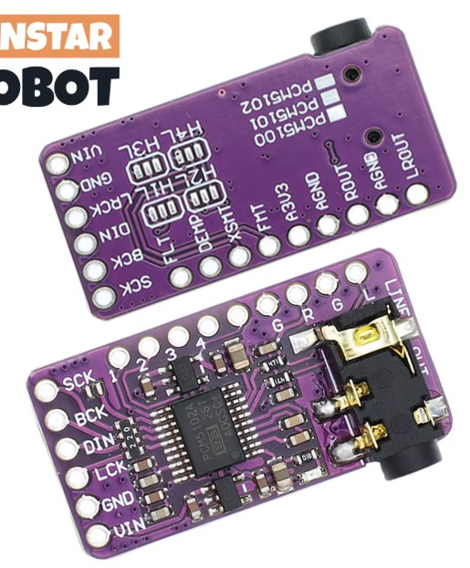
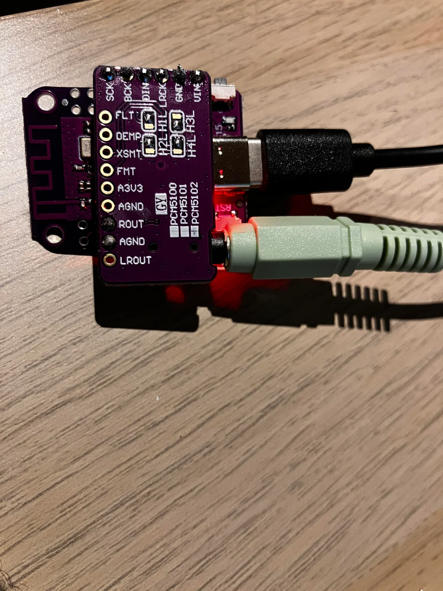

# smart-speaker-esp32-s2

A small Wi-Fi smart speaker built from an ESP32-S2 mini and a PCM5102 I2S DAC board with a 3.5 mm audio jack.

## Hardware

Note: choose the PSRAM version, which is important for the sendspin

| Part | Description |
| --- | --- |
| Microcontroller | [ESP32-S2 mini (LOLIN S2 mini with 2MB PSRAM)](https://www.espboards.dev/esp32/lolin-s2-mini/) |
| Audio board | PCM5102 I2S DAC with 3.5 mm jack |

### PCM5102 audio board

## Pin map

| PCM5102 pin | ESP32-S2 mini pin |
| --- | --- |
| VIN | VBUS |
| GND | GND |
| LRCK | GPIO16 |
| DIN | GPIO18 |
| BCK | GPIO33 |
| SCK | GPIO35 |

## Soldered result

## ESPHome pin configuration

Two versions: web audio and sendspin in file speaker-s2-min.yml and speaker-s2-min-sendspin.yml

## Notes

- **SCK / MCLK:** the PCM5102 generates its own clock from BCK, so do not configure `i2s_mclk_pin` on GPIO35. Driving it caused constant background noise.
- **Noise when touching the board:** a floating SCK pin acts as an antenna. If you hear crackling or interference that changes when you move your hand near the DAC, tie SCK to GND (solder pad or wire) so it is held at a fixed level.
- **Jack strain:** the board is held by its solder joints, so plugging in the 3.5 mm jack can flex the wires. Fix the DAC board with a standoff, glue or foam tape, or put both boards in a case.
- **Power:** VIN is connected to VBUS (5 V from USB), which suits boards with an on-board regulator.
